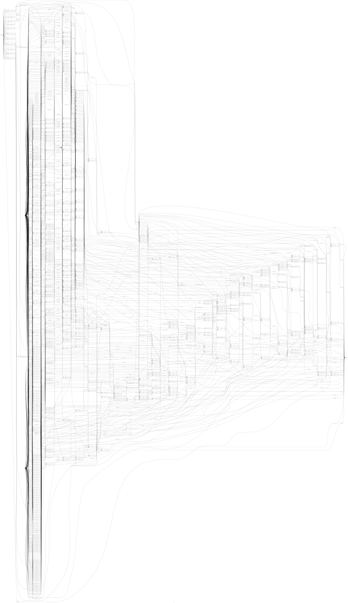
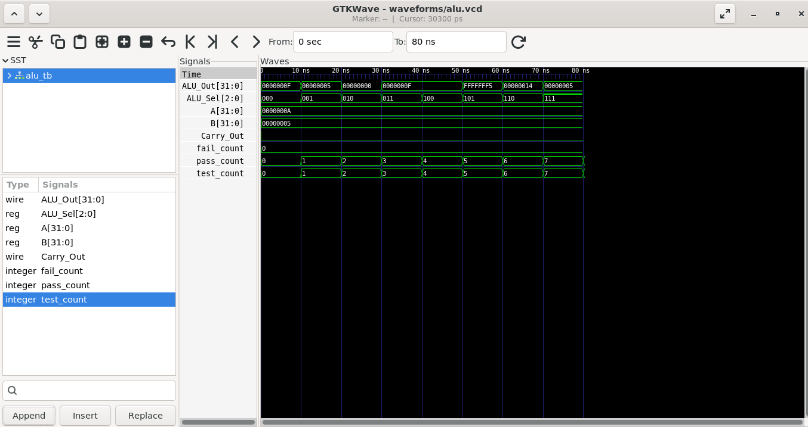

# Docker-Based VLSI Verification & PPA Analysis

**Verilog RTL | ALU Design | EDA Automation | Sky130 HD**

An automated framework for functional verification, logic synthesis, timing analysis, power estimation, and baseline-versus-optimized comparison of a Verilog Arithmetic Logic Unit (ALU).

## Problem Statement

Manual RTL verification and PPA analysis can be repetitive and difficult to reproduce. This project automates essential digital-design analysis stages using scripts, a Makefile, and a Docker-based environment.

## Design Flow

```text
Verilog RTL + Testbench
         |
         v
     RTL Linting
         |
         v
 Functional Simulation
         |
         v
   Logic Synthesis
         |
         v
Timing & Power Analysis
         |
         v
Baseline vs Optimized
         |
         v
  Reports and Results
```

## Key Features

- Automated RTL linting and functional simulation
- ALU synthesis using Sky130 HD standard-cell libraries
- Static timing analysis
- Estimated power analysis
- Baseline-versus-optimized implementation comparison
- Automated scripts and Makefile workflow
- Simulation waveform generation
- Synthesis schematic visualization

## Design Visualizations

### Optimized ALU Synthesis Schematic



The schematic illustrates the optimized ALU synthesis result.

### ALU Functional Simulation Waveform



The waveform provides visual evidence of ALU input signals, operation selection, output behavior, and associated simulation signals.

## Results at a Glance

| Metric | Baseline | Optimized | Improvement |
|---|---:|---:|---:|
| Cell count | 527 | 464 | 11.95% lower |
| Area | 3,080.45 µm² | 2,840.22 µm² | 7.80% lower |
| Critical path | 10.11 ns | 7.06 ns | 30.17% lower |
| Slack | 1.89 ns | 4.94 ns | +3.05 ns |
| Estimated power | 0.102 mW | 0.100 mW | 1.96% lower |
| Functional tests passed | 8/8 | 8/8 | Both passed |

**Verification:** The comparison report records eight passed functional tests for each implementation and zero failed tests.

**Timing:** The reported critical path decreases from 10.11 ns to 7.06 ns. Timing is pre-layout and depends on the applied constraints.

**Power:** Power is estimated using the configured default activity; it is not a measurement of fabricated silicon.

See `reports/ppa/comparison_report.txt` for the comparison summary.

## Tools & Technologies

- Verilog HDL
- Verilator
- Icarus Verilog
- Yosys
- OpenSTA
- Sky130 HD standard-cell library
- Docker
- Linux, Bash, and Makefile

## Project Structure

```text
docker-vlsi-framework/
├── rtl/             # RTL source
├── tb/              # Testbenches
├── scripts/         # Automation scripts
├── constraints/     # Timing constraints
├── lib/             # Library-related files
├── docs/
│   └── images/      # Project visualizations
├── reports/         # Analysis reports
├── results/
│   ├── baseline/    # Baseline implementation outputs
│   └── optimized/   # Optimized implementation outputs
├── waveforms/       # Simulation waveforms
├── Dockerfile
├── Makefile
└── README.md
```

## Run the Workflow

Run the following commands from the project directory in the configured environment:

```bash
make all
./scripts/run_comparison.sh
```

Inspect the `reports/` and `results/` directories for generated outputs.

## Engineering Concepts Demonstrated

- RTL design and functional verification
- Digital logic and ALU operations
- Logic synthesis and standard-cell mapping
- Static timing analysis
- Power estimation and PPA comparison
- Linux scripting and workflow automation

## Limitations

Results depend on the selected constraints, libraries, and tool configuration. Pre-layout timing and estimated power do not represent final silicon performance or complete ASIC signoff.

## Future Work

- Automated regression and coverage reporting
- Additional benchmark designs
- Consolidated PPA visualization
- Continuous integration with GitHub Actions

## Author

**Sai Lakshmi**
B.Tech, Electronics and Communication Engineering
GitHub: [sainusum47-dev](https://github.com/sainusum47-dev)
